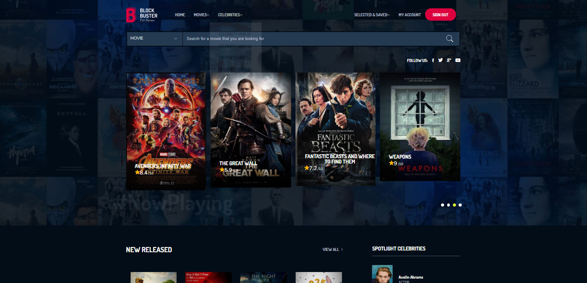
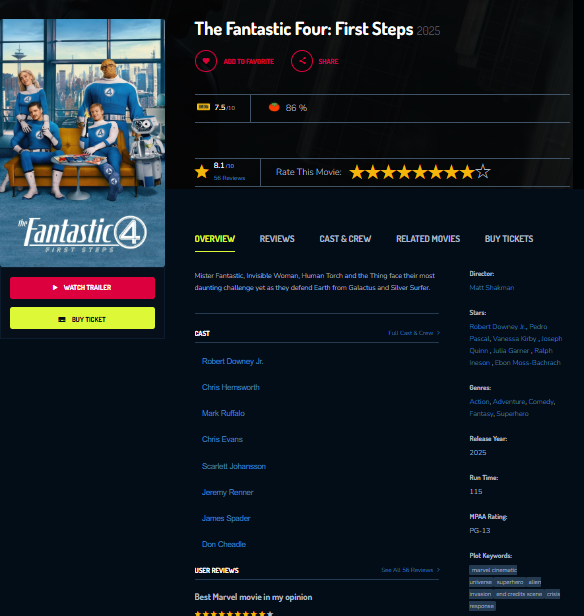
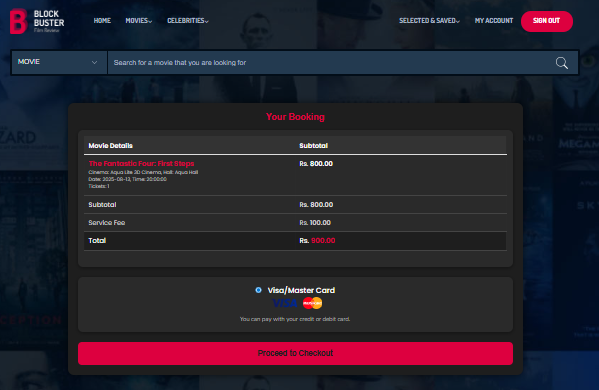
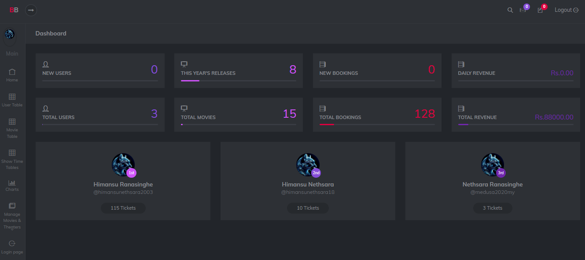
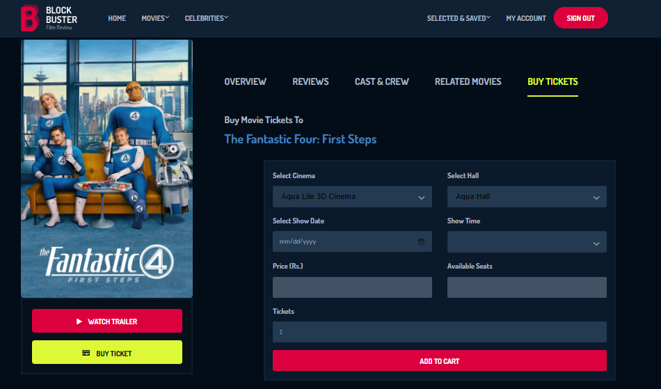
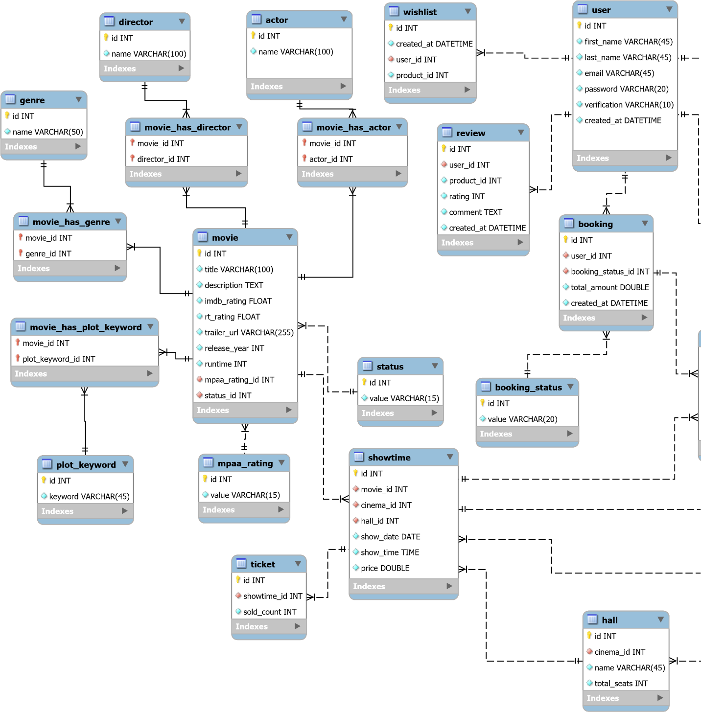
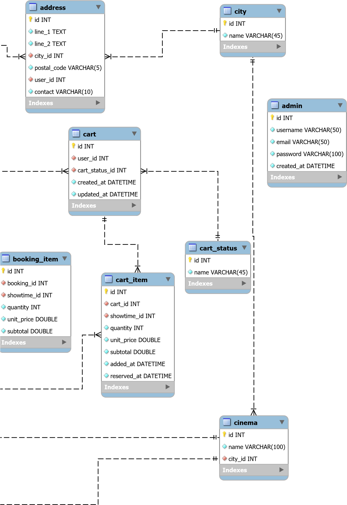

<h1 align="center">🎬 BlockBuster Ticket Booking</h1>

  
  
  
  
  
  

  <strong>BlockBuster</strong> is an end-to-end cinema ticket booking platform where users can browse movies, reserve seats, pay securely, and receive PDF tickets via email. It features a comprehensive administrative dashboard for complete cinema management.

---

## 📖 Overview

**BlockBuster** is a classic monolithic MVC-style Java EE web application. It provides a seamless booking experience by integrating live seat inventory tracking, a 45-minute cart reservation system, secure payment processing via PayHere, and asynchronous email delivery of PDF tickets. 

The backend is powered by Java Servlets and Hibernate ORM mapping to a MySQL database, while the frontend is a responsive Bootstrap interface enhanced with JavaScript AJAX calls.

## ✨ Key Features

### 🍿 Customer Experience
- **Authentication:** Secure registration with email verification codes, login, and password recovery.
- **Movie Discovery:** Browse by category (Recent, Yearly, IMDb Top Rated), view showtimes, and check seat availability.
- **Smart Cart:** 45-minute reservation expiry logic to prevent overselling. Guest and logged-in carts.
- **Checkout & Payments:** Integrated with PayHere Hosted Checkout for secure transactions.
- **Automated Ticketing:** Instant generation of A5 PDF tickets and asynchronous email delivery via Gmail SMTP.
- **User Dashboard:** View booking history and ticket details.

### 🎟️ Administration
- **Analytics Dashboard:** Real-time stats on revenue, bookings, ticket sales, and top customers using Chart.js.
- **Cinema Management:** Full CRUD operations for movies, actors, directors, genres, cities, cinemas, halls, and showtimes.
- **User Management:** View user lists and manage movie statuses.

## 🛠️ Technology Stack

| Category | Technologies |
| :--- | :--- |
| **Backend** | Java 7, Java EE 7, Servlets 3.1, Hibernate 4.3, C3P0, EHCache |
| **Frontend** | HTML5, CSS3, JavaScript (jQuery 3.3), Bootstrap 4.1, Chart.js |
| **Database** | MySQL 8.0 |
| **PDF & Email** | OpenPDF 1.3, JavaMail API (Gmail SMTP) |
| **Payments** | PayHere Hosted Checkout |
| **Server** | GlassFish 5 |

## 📸 System Showcase

| Storefront Home | Movie & Showtimes | Checkout |
| :---: | :---: | :---: |
|  |  |  |

| Admin Dashboard | Ticket Generation |
| :---: | :---: |
|  |  |

## 🗄️ Database Schema

The application uses a robust relational database (`block_buster`) mapped via Hibernate. 

**Key Relationships:**
- **Users & Auth:** `User`, `Admin`, `Address` (One-to-Many from User).
- **Cinema Structure:** `City` → `Cinema` → `Hall` (Hierarchical).
- **Movie Data:** `Movie` (Many-to-Many with `Actors`, `Directors`, `Genre`).
- **Operations:** `Showtime`, `Ticket`, `Cart`, `Booking` (One-to-Many with their respective items).

**Entity-Relationship Diagram:**
*(Note: The ER diagram is split into two parts)*

  
  

## 🏗️ System Architecture

The system follows a **classic monolithic MVC architecture**:

1. **Presentation Layer:** Static HTML/CSS/JS pages interacting with Servlets via AJAX. Uses Bootstrap for responsive design.
2. **Controller Layer (Servlets):** Processes HTTP requests, manages sessions (using `HttpSession`), and uses `Gson` to return JSON responses. `Servlet Filters` protect secure routes.
3. **Business/Data Layer (Hibernate):** `HibernateUtil` manages the SessionFactory. Transactions handle atomic seat reservations and checkout logic.
4. **Payment & Ticketing Pipeline:** 
   - User submits checkout → Pending booking created → PayHere payload returned.
   - PayHere posts notification to `/VerifyPayments`.
   - System verifies MD5 signature → Generates PDF via OpenPDF → Emails ticket via JavaMail.

## 🚀 Known Limitations & Future Enhancements

*(Note: This project was built to explore Java EE enterprise patterns. The following improvements are identified for production readiness).*
- [ ] **Security:** Move all hardcoded secrets (DB, Gmail SMTP, PayHere Merchant Secret) to environment variables.
- [ ] **Security:** Implement BCrypt password hashing and a secure reset token flow (currently uses plaintext and emails the actual password).
- [ ] **Security:** Add CSRF protection and robust role-based endpoint authorization.
- [ ] **Architecture:** Implement database locking (pessimistic/optimistic) during checkout to prevent concurrent overselling.
- [ ] **Architecture:** Improve payment callback idempotency and reliable state transitions for booking status.
- [ ] **Testing:** Add JUnit, Mockito, and integration tests for the booking pipeline.
- [ ] **Dependencies:** Upgrade from legacy Java 7 / Hibernate 4 to modern Java 17 / Hibernate 6.

## 👨‍💻 Author

**Himansu Nethsara Ranasinghe**
- 🎓 BSc (Hons) Software Engineering Undergraduate (JIAT / BCU)
- 🔗 [LinkedIn](https://www.linkedin.com/in/himansu-nethsara/)
- 🐙 [GitHub](https://github.com/HimansuNethsara)